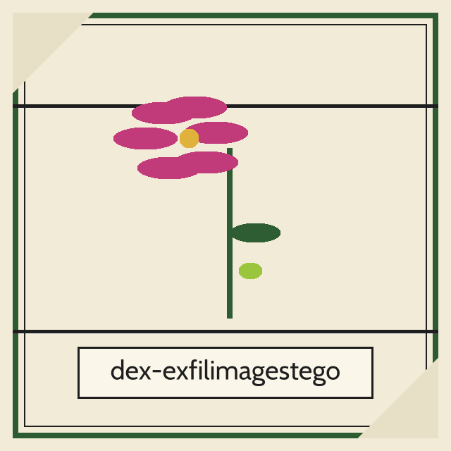
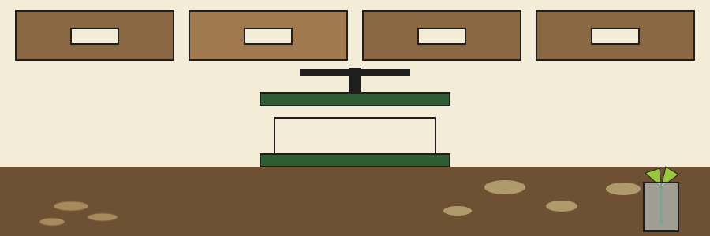
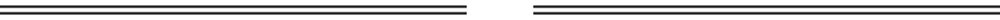

# dex-exfilimagestego

Title block: the name above is set in Bpmf Zihi Kai Std in rain black on pale paper, with a strap line beneath it and one small pressed flower beside the first heading only, in the manner of a label on a cabinet drawer.

# dex-ExfilImageStego
Embeds data within a PNG image using LSB steganography. Takes data and an image as input, outputs a new PNG image containing the hidden data. - Focused on Simulates data exfiltration techniques by generating realistic fake data (e.g., usernames, passwords, financial records), staging it in various formats, and then simulating its transmission over different protocols (e.g., HTTP, DNS tunneling). Used for testing data loss prevention (DLP) systems and incident response playbooks.

## Install
`git clone https://github.com/ShadowGuard-AI/dex-exfilimagestego`

## Usage
`python3 main.py IMAGE_PATH`

> Pasted label: there is no extraction run. The program writes a picture carrying hidden bytes and offers no way back, no reader and no reverse run, so a finished run cannot be undone by this tool.

## Parameters
- `IMAGE_PATH`: Path to the PNG image to use as a cover image.
- `-h`: Show help message and exit
- `-o`: Path to save the steganographically encoded PNG image (default: `output.png`).
- `-d`: Path to a file containing data to embed. If not provided, fake data is generated.
- `-g`: Generate fake data for embedding. Overrides --data_file.
- `-s`: Size of fake data to generate, in bytes (default: 1024). Only applicable with `-g`.
- `-e`: Simulated exfiltration protocol, `http` or `dns` (optional).

> Pasted label: alpha carries a quarter of every byte. The cover picture is converted to RGBA and each pixel holds one byte, two bits in each channel, so flattening the result or dropping alpha destroys a quarter of the hidden bytes.

> Pasted label: the size option is ignored unless the generate flag is set. In the default branch, with neither a data file nor the generate flag, the program fixes its own 1024 bytes and never looks at the size flag.

> Pasted label: the protocol option sends nothing. Choosing http or dns adds two log lines saying a simulation ran, and no socket is opened and no query is issued.

## Verified run note

The parameters above are taken from the argument parser in `main.py`. A live run in this environment is blocked because the `faker` package is not installed here, so even `--help` stops at that import; no run result is claimed for this tool.

## License
Licensed under the terms in LICENSE.

## Drawer notes, gathered in the pressing room

The buttons of this re-skin read Hide the Data, Invent the Filler, and Open the Drawer Notes. Its headings read One Way Only, One Byte in Every Pixel, Alpha Carries a Quarter, Filler, Not Records, and Two Log Lines, Nothing Sent. Two facts are entered once more at full size: capacity in bytes equals the pixel count of the cover picture, the four length bytes included, and the repository LICENSE file carries the MIT License, its holder line joining the public pen name to a shortened form in parentheses and the account handle, the shortened form staying shortened here.
